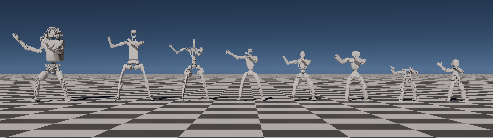

# MAHR



## About this project

MAHR provides a pipeline for retargeting human motion capture data to humanoid robots,
based on *Morphology-Agnostic Humanoid Retargeting via Perceptual Motivated Graph
Similarity*. It focuses on efficient processing of individual motions across robots
with different body proportions and joint configurations.

The project supports BVH and SMPL-X input, eight robot models, height-map terrain, multi-motion
batch processing, trajectory export, and video playback. Robot models, meshes,
reference poses, an example height map, and two example motions are included
in this repository. The commands below reproduce both motions on all supported robots
and compare their results in a single video.

By default, MAHR scales horizontal motion by reference body height and refines the
root path using fixed ground-grid relationships to reduce foot sliding. Source body
pose matching helps preserve the motion through graph refinement. The same workflow
applies to all eight robots, without additional configuration.

The output consists of kinematic trajectories for motion analysis, data preparation,
and downstream control research. Temporal regularization encourages continuity;
joint and root speeds are not hard-limited. Ground penetration may occur, and dynamic balance,
self-collision, and contact forces are not validated by this pipeline.

## How to use

Run the following commands from the root directory of this repository. The Python
module and command-line entry point are both named `mahr`. The examples below use
Linux and Bash.

### Installation

#### 1. Create the virtual environment with uv

Use [uv](https://docs.astral.sh/uv/getting-started/installation/) to create the virtual
environment and install dependencies. Install uv before running the commands below.
Python 3.10 or higher is required; the examples use Python 3.10 and the tested core
dependency versions:

```bash
uv venv --python 3.10 .venv
source .venv/bin/activate
uv pip install -e . "numpy==2.2.6" "scipy==1.15.3" "mujoco==3.9.0"
```

Keep this environment active for all commands below. In a new shell, run
`source .venv/bin/activate` again before retargeting, rendering, or running tests.

#### 2. (Optional) Install visualization dependencies

Video rendering requires FFmpeg, including `ffprobe`, and OSMesa. On Debian or Ubuntu:

```bash
sudo apt-get install ffmpeg libosmesa6
```

The examples use OSMesa for rendering without a display. These system dependencies
are only needed when exporting videos.

### Preparing Mocap Data

The built-in mappings use AMASS/SMPL joint names. BVH input uses the Y-up convention.
Two converted motions are included under `assets/motions/`:

| Motion | BVH file | Frames |
| --- | --- | ---: |
| Dance | `DanceDB_SMPLHG/Clio_Haniotikos_C3D_poses_short.bvh` | 500 |
| SMPL example | `smpl_h_small.bvh` | 319 |

For other motions, supply a BVH file with the same joint names, coordinate convention,
and length units as the included examples. BVH files with a different skeleton require
a corresponding mapping. SMPL-X NPZ motions can be loaded directly as described below.
SMPL/SMPL-H parameter files and CMU ASF/AMC files require conversion or a separate
input adapter; they are not interchangeable with SMPL-X parameters.

#### SMPL-X motion data and body models

Prepare two downloads: a **body model**, which defines the person's body shape and
joints, and **motion data**, which supplies the poses over time. AMASS SMPL-X motions
can be used directly after extraction. Use the uv environment from the installation
section for the checks and commands below.

##### 1. Download the SMPL-X body models

Register and sign in on the [SMPL-X download page](https://smpl-x.is.tue.mpg.de/download.php),
accept the applicable model terms, and download the SMPL-X models with the full shape
and expression space. This workflow was validated with a full SMPL-X v1.1 model.
Extract the archive and copy its neutral, female, and male model files into:

```text
assets/body_models/smplx/
  SMPLX_NEUTRAL.npz
  SMPLX_FEMALE.npz
  SMPLX_MALE.npz
```

This directory is ignored by Git. Official model `.npz` files are preferred; trusted
model `.pkl` files with the same names are also accepted. Use the full model when a
motion has more than ten `betas`; a compact model with ten shape coefficients cannot represent those
coefficients. Preserve the motion's shape coefficients instead of truncating them.

You can keep them elsewhere and pass their directory or a specific model file through
`--smplx-model`. A directory may contain the files directly or inside `smplx/`.
The motion's `gender` selects the model; absent gender defaults to neutral. Use
`--smplx-gender` only when intentionally overriding that selection, which changes the
body model used to interpret the motion. MAHR reads these files with its existing
dependencies; installing the `smplx` package or editing its source is unnecessary.

##### 2. Download and extract AMASS SMPL-X motions

Register and sign in on the [AMASS download page](https://amass.is.tue.mpg.de/download.php),
accept the terms for the datasets you want, and select their **SMPL-X** downloads.
For example, start with the DanceDB subset. The SMPL+H/SMPL-H downloads use a different
parameter layout and cannot be passed to this loader or converted by padding poses
with zeros.

Extract each downloaded archive into a motion directory separate from the body models
and output trajectories. For a tar archive, replacing both example paths:

```bash
mkdir -p /path/to/amass
tar -xf /path/to/downloaded_amass_smplx_archive.tar.bz2 -C /path/to/amass
```

Keep the extracted dataset and subject directories. One DanceDB motion is
`DanceDB/20120807_CliodelaVara/Clio_Haniotikos_C3D_stageii.npz`; adjust the input path
to the actual extraction layout. The examples below use `/path/to/amass/clip_stageii.npz`
as a placeholder for a selected motion file. Keep model files and unrelated NPZ files
outside the motion directory, since batch mode treats NPZ files as motion inputs.

##### 3. Check the input before retargeting

Run this check with the downloaded models and one extracted motion:

```bash
python - /path/to/amass/clip_stageii.npz <<'PY'
import sys
from mahr import SMPLXSource

source = SMPLXSource("assets/body_models/smplx")
motion, _ = source.read(sys.argv[1])
print(f"{len(motion.positions)} frames at {motion.fps:g} Hz; "
      f"{len(motion.names)} joints; positions in {motion.units}")
PY
```

A valid input reports 55 joints. Keep AMASS translations in meters, rotations in
radians, and the recorded frame rate. MAHR uses AMASS Z-up coordinates by default
and calibrates the source floor automatically. No BVH conversion, manual ground
offset, or advance resampling is required. Continue with
[Retargeting SMPL-X motions](#retargeting-smpl-x-motions) to produce robot trajectories.

If loading fails, check that the model for the motion's gender exists, that you selected
the SMPL-X dataset variant, and that the model supports all supplied shape coefficients.

##### Parameters exported by other tools

For another data source, export a NumPy `.npz` file with numeric parameter arrays and
scalar metadata using the fields below. Raw `.pt` predictions and dataset
pickle containers need to be converted to this layout before loading.

| Parameter | Accepted fields and shape |
| --- | --- |
| Root translation, in meters | `trans` or `transl`: `[frames, 3]` |
| Pose, in axis-angle radians | `poses`: `[frames, 165]`, or the separate fields below |
| Root and body pose | `root_orient`/`global_orient`: `[frames, 3]`; `pose_body`/`body_pose`: `[frames, 63]` |
| Shape | `betas`: `[coefficients]`, `[1, coefficients]`, or `[frames, coefficients]` |
| Frame rate | Positive scalar `mocap_frame_rate`, `mocap_framerate`, or `fps` |

Separate poses can also include `pose_hand` (`[frames, 90]`) or
`left_hand_pose`/`right_hand_pose` (`[frames, 45]` each), plus jaw and eye rotations.
Omitted hand and facial rotations are zero. Optional `expression` coefficients are
supported. A full `poses` array takes precedence over separate fields and follows
SMPL-X order: root (3), body (63), jaw (3), left eye (3), right eye (3), left hand (45),
and right hand (45). All per-frame arrays must have the same frame count.

Store `gender` as `neutral`, `female`, or `male`; if supplied, `surface_model_type` or
`model_type` must be `smplx`. Hand poses use full axis angles; expand PCA hand
coefficients using the exporting tool's matching body model first. Angles are absolute
by default; use `--smplx-hand-mean model` for values relative to the model's hand mean.
For Y-up motion files, pass `--smplx-up-axis y` (or `up_axis="y"` in Python).
Preserve the producer's coordinate and hand conventions when preparing the arrays.

### Robot Models

The supported robot models are included under `assets/robots/`.
Use the supplied URDF files together with their referenced meshes. The `--robot`
argument selects the target model for retargeting.

The URDF paths below are relative to `assets/robots/`:

| Robot | `--robot` | URDF path |
| --- | --- | --- |
| Unitree G1 | `g1` | `unitree_g1/g1_29dof_stl.urdf` |
| Unitree H1 | `h1` | `unitree_h1/urdf/h1_stl.urdf` |
| Fourier GR1 | `gr1` | `Fourier_GR1/GR1.urdf` |
| Fourier N1 | `n1` | `Fourier_N1/urdf/N1_raw_stl.urdf` |
| Agibot X1 | `x1` | `Agibot_X1/urdf/x1_stl.urdf` |
| Berkeley Humanoid Lite | `berkeley` | `Berkeley_Humanoid_Lite/berkeley_humanoid_lite_stl.urdf` |
| Boston Dynamics Atlas HD | `atlas` | `Boston_Dynamics_Atlas/urdf/atlas_v4_with_multisense_stl.urdf` |
| iCub | `icub` | `iCub/robots/iCubGazeboV2_7/model_stl.urdf` |

Retargeting uses this checkout's `assets/` directory by default. If you store the
assets elsewhere, pass `--asset-root /path/to/assets` to either `python -m mahr` or
`scripts/retarget_all.py`, preserving the `robots/` and `motions/` subdirectories.

### Retargeting Motion Capture Data to Robots

For example, to retarget the Dance motion to Unitree G1:

```bash
python -m mahr \
  assets/motions/DanceDB_SMPLHG/Clio_Haniotikos_C3D_poses_short.bvh \
  --robot g1 -o results/g1.json
```

The retargeted joint angles, root positions, root orientations, and frame rate are
saved in `results/g1.json`. Solver statistics are saved in `results/g1.stats.json`.

Replace `g1` with another name from the table to change the target robot, or replace
the input path to process another compatible motion. Use `--frames 120` to select
the first 120 source frames and `--stride 2` to sample every second frame.
Run `python -m mahr --help` for the available options.

#### Retargeting SMPL-X motions

After [preparing the models and motion data](#smpl-x-motion-data-and-body-models),
try the first 120 source frames on G1:

```bash
python -m mahr /path/to/amass/clip_stageii.npz --robot g1 \
  --smplx-model assets/body_models/smplx --frames 120 -o results/g1_smplx.json
```

The command writes `results/g1_smplx.json` and `results/g1_smplx.stats.json`.
Remove `--frames 120` to process the complete clip. `--stride 2` keeps every second
source frame and adjusts the output frame rate to preserve playback speed; it does
not select a fixed output frequency.

Render a small 30 Hz preview after installing the optional visualization dependencies:

```bash
MUJOCO_GL=osmesa python scripts/render_motion.py results/g1_smplx.json \
  --urdf assets/robots/unitree_g1/g1_29dof_stl.urdf \
  --fps 30 --width 320 --height 240 --bitrate 120 \
  -o results/g1_smplx.mp4
```

To process the extracted motion directory on all eight robots:

```bash
python -m mahr /path/to/amass --robot all \
  --smplx-model assets/body_models/smplx -o results/smplx_batch
```

Batch output preserves the dataset and subject directories beneath each robot's
directory. Check `results/smplx_batch/batch_summary.json` for failed or unconverged
tasks. SMPL-X input also accepts the terrain options described below.

The Python API accepts a reusable source object:

```python
from mahr import SMPLXSource, run, save_result

source = SMPLXSource("assets/body_models/smplx")
result = run("assets", "/path/to/amass/clip_stageii.npz", robot="g1", smplx=source)
save_result(result, "results/g1_smplx.json")
```

#### Retargeting on non-flat terrain

Pass a height map to adapt a motion to a different target ground surface. For example,
use the included ramp with an 8 m × 8 m footprint:

```bash
python -m mahr assets/motions/smpl_h_small.bvh --robot g1 \
  --height-map assets/terrains/ramp.png \
  --terrain-half-size 4 4 --terrain-elevation 0.4 \
  -o results/g1_ramp.json
```

Height maps must be 8-bit grayscale PNGs. Black represents zero height and white
represents `--terrain-elevation` meters. `--terrain-half-size X Y` sets half the map's
width and depth; its default is `20 20`. Image columns increase along world X and
rows run from positive to negative world Y. Use `--terrain-origin X Y Z` to move the
map's center and base height; the default is `0 0 0`. Outside the map footprint,
height queries use the nearest boundary. Choose a footprint covering the robot's path.

The source motion still uses a calibrated horizontal floor. The supplied height map
describes the target terrain. Retargeting adjusts joint angles and root height while
refining the height-scaled horizontal path; it does not plan a route around obstacles.
Omit `--height-map` for the default flat ground.

Terrain runs also save `g1_ramp.terrain.npz` next to the trajectory. Keep these files
together when moving results: the renderer loads the saved terrain automatically,
without needing the input PNG or additional terrain arguments.

#### Processing multiple motions

Supply a directory to recursively process its BVH and SMPL-X NPZ motions. Select all robots with
`--robot all`, or repeat the option, for example `--robot g1 --robot x1`:

```bash
python -m mahr assets/motions --robot all -o results/motion_batch
```

This command processes both included motions on eight robots. Files and directories
whose names start with `norm_pose` and exported `.terrain.npz` files are excluded from
directory scans. File extensions are case-insensitive. Supply `--smplx-model` when
the directory includes SMPL-X motions; keep body-model files outside the motion
directory. A single input file with multiple target robots also uses batch mode.

In batch mode, `-o` is an output directory. Each robot gets a subdirectory that preserves
the input motion's relative path, for example
`results/motion_batch/g1/DanceDB_SMPLHG/Clio_Haniotikos_C3D_poses_short.json`.
This keeps motions with the same filename in different directories separate.
`--frames`, `--stride`, and terrain options apply to every task.

The batch continues after individual failures and records completed tasks in
`batch_progress.jsonl`. It finalizes `batch_summary.json` on completion or a Ctrl-C
interruption. The command exits with a nonzero status if any task fails or any frame
does not converge. Non-converged trajectories remain available for inspection.
Read the summary before using a batch in downstream applications.

### Visualizing Retargeted Motions

Use `scripts/render_motion.py` to render a trajectory with the corresponding robot
URDF. For the G1 result above:

```bash
MUJOCO_GL=osmesa python scripts/render_motion.py results/g1.json \
  --urdf assets/robots/unitree_g1/g1_29dof_stl.urdf \
  -o results/g1.mp4
```

The first argument points to the trajectory JSON, `--urdf` selects the playback
model, and `-o` specifies the output video. Videos play at the original motion speed.
The scene uses a white sky and a gray/white checker floor; `--no-ground-grid` selects
a uniform gray floor. For another robot, use its URDF path from the model table.

For a low-bandwidth preview at exactly 30 fps, use a smaller frame size and a bitrate
budget in kbit/s. The ground grid also makes terrain shape easier to see:

```bash
MUJOCO_GL=osmesa python scripts/render_motion.py results/g1_ramp.json \
  --urdf assets/robots/unitree_g1/g1_29dof_stl.urdf \
  --fps 30 --width 320 --height 240 --bitrate 120 --ground-grid \
  -o results/g1_ramp_small.mp4
```

`--fps` samples the original trajectory at evenly spaced timestamps and preserves
playback speed. It is an alternative to `--stride`. `--bitrate` sets the H.264 target
and maximum rate; short buffering bursts are allowed. MP4 files are prepared for
progressive playback. Use `--camera-distance` in meters to adjust the framing.

For a terrain result, use the same command with `results/g1_ramp.json`; its adjacent
terrain file supplies the scene geometry. To render every completed trajectory in a
multi-motion batch:

```bash
python scripts/render_all.py results/motion_batch
```

Videos are written alongside their trajectory files. Tasks that failed before export
are skipped; non-converged results are rendered for inspection. You can run this command
while a batch is still processing: it reads the completed tasks available at startup.
Run it again to include later results.

### Reproducing the Examples on All Robots

Run both example motions on all eight robots:

```bash
python scripts/retarget_all.py \
  --motion assets/motions/DanceDB_SMPLHG/Clio_Haniotikos_C3D_poses_short.bvh \
  --output results/all_robots_dance

python scripts/retarget_all.py \
  --motion assets/motions/smpl_h_small.bvh \
  --output results/all_robots_smpl
```

Together, these runs produce 6552 frames of robot motion. The script checks output
values, joint limits, and solver status. Successful runs report `failed 0` for each
robot and write a `summary.json` file in each output directory.

Render the individual videos and combine them into comparison videos and GIFs:

```bash
for clip in dance smpl; do
  python scripts/render_all.py "results/all_robots_${clip}"
  python scripts/make_gallery.py "results/all_robots_${clip}"
done
```

Batch rendering selects the robot models automatically and uses OSMesa. Each directory
contains the robot trajectories and statistics, individual videos such as `g1.mp4`,
and the comparison files `all_robots.mp4` and `all_robots.gif`. The complete results
are also packaged as `results/all_robots_dance_results.zip` and
`results/all_robots_smpl_results.zip`.

Generated results are stored under `results/` and are not included in Git. The commands
above regenerate them from the supplied assets. You can also check the installation
and basic functionality with:

```bash
python -m unittest discover -s tests -q
```

## Acknowledgements

We would like to thank the following projects:

- [MuJoCo](https://github.com/google-deepmind/mujoco) for robot kinematics and visualization.
- NumPy and SciPy for numerical computation and optimization.
- The robot model authors and motion capture dataset contributors.

## License

The code is released under the [MIT License](LICENSE). Robot assets and motion data
remain subject to their respective licenses; model-specific license files are
included alongside the assets.
